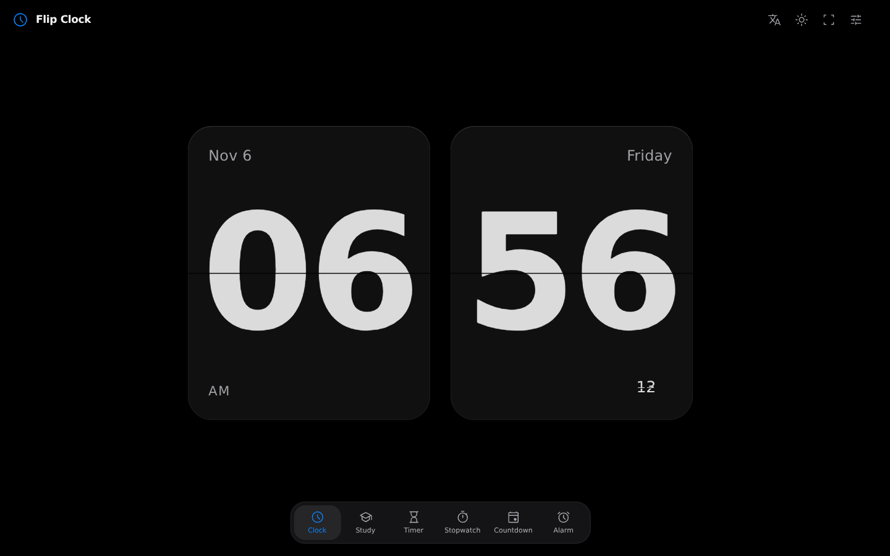
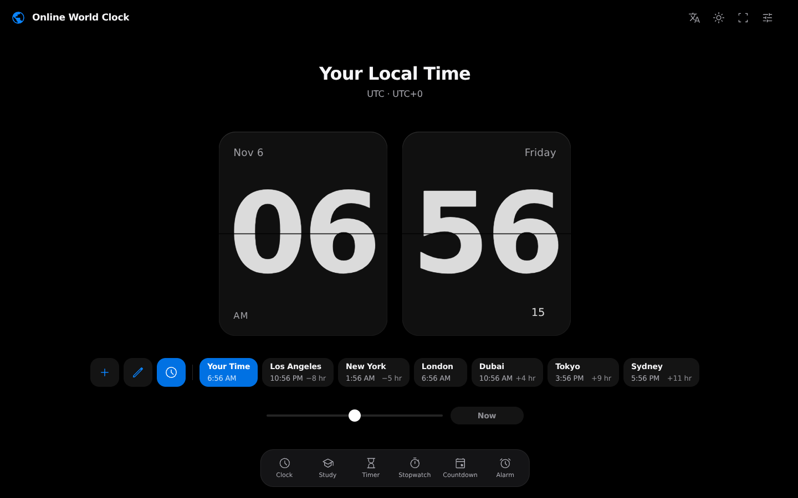
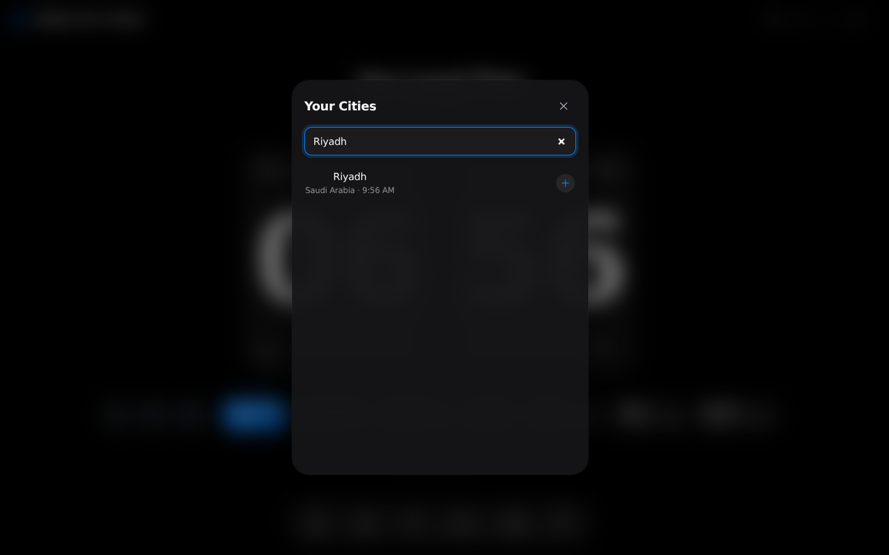
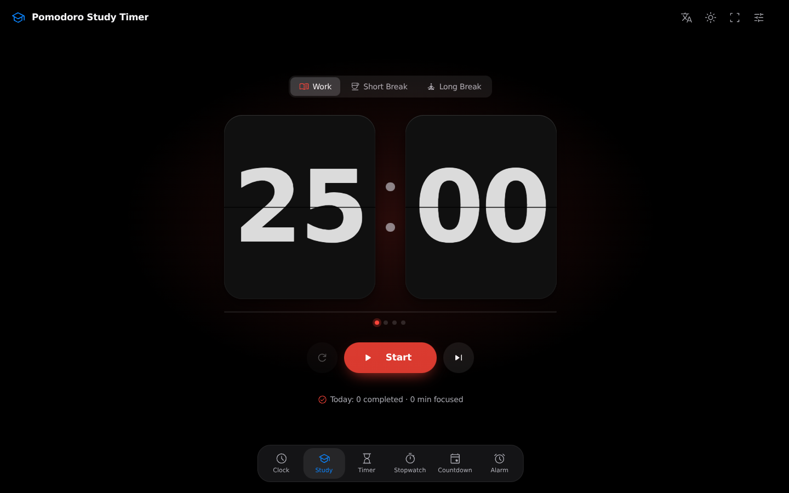
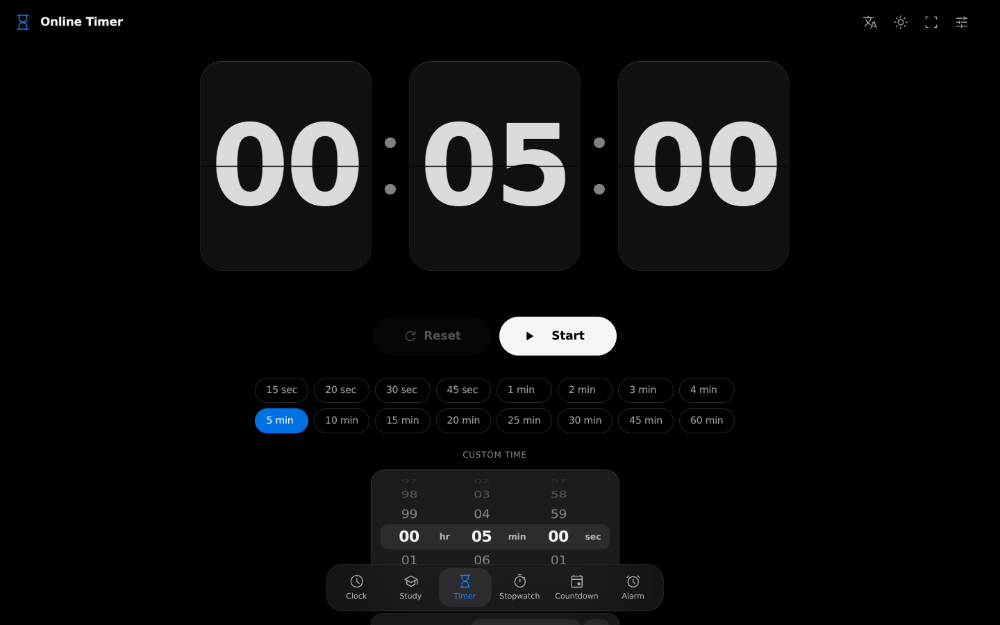
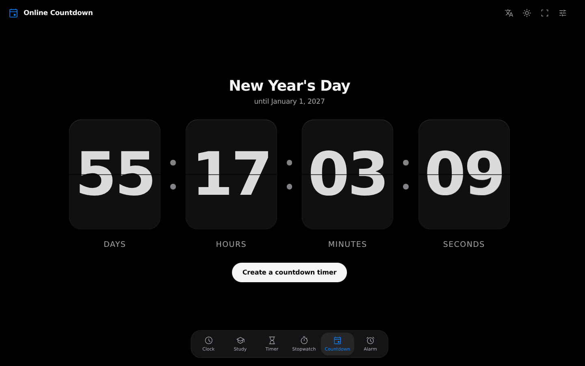
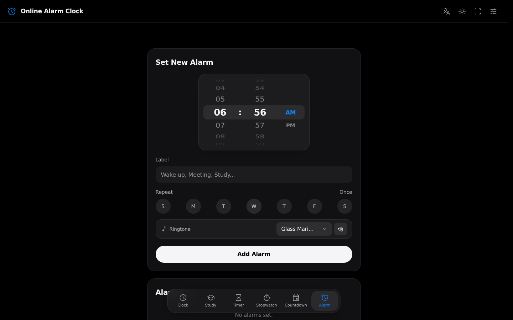
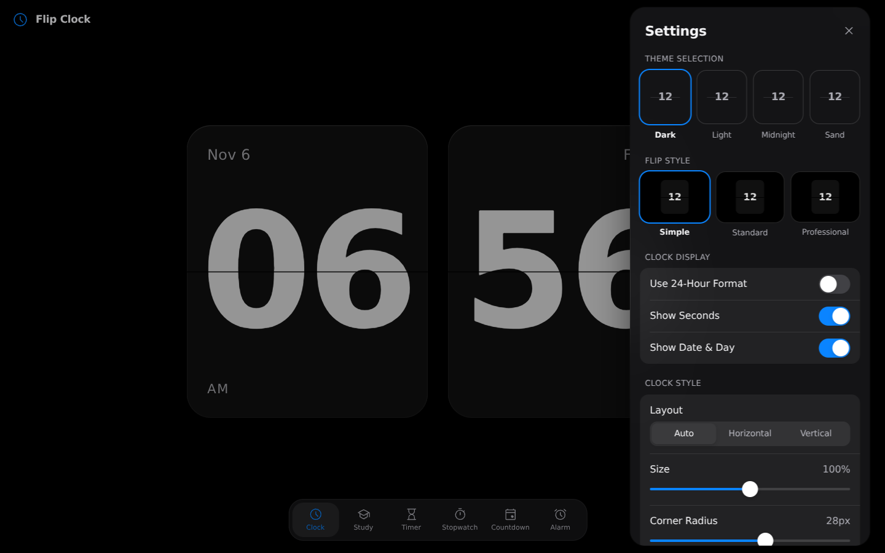
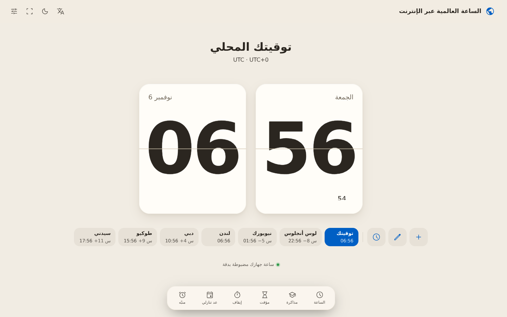
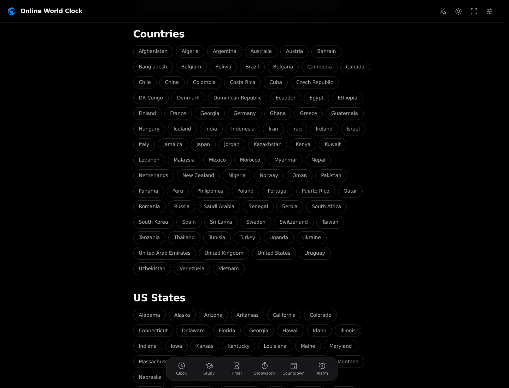

# SplitDeck

A browser-based suite for reading, comparing, and timing the day. SplitDeck combines a flip-style local clock, a city-focused world clock, and five dedicated timing tools in one responsive interface.



## The seven views

1. **Local clock** — large flip cards with 12/24-hour format, seconds, date and weekday, fullscreen, and display controls.
2. **World clock** — compare saved cities, search the city directory, and use a 15-minute-step planner to shift the comparison time by up to 24 hours in either direction. Country and U.S. state directories select representative cities.
3. **Study timer** — work, short-break, and long-break sessions; configurable cycles and daily goals; tasks, session history, progress summaries, CSV export, and an optional focus tick.
4. **Timer** — quick durations from 15 seconds through 60 minutes, or a custom duration up to 99:59:59.
5. **Stopwatch** — centisecond display, lap splits, and fastest/slowest lap highlighting.
6. **Countdown** — a saved event date and time, quick presets, holiday suggestions, and an optional completion alert.
7. **Alarm clock** — one-time or repeating alarms, labels, ringtone previews, volume and gradual-volume controls, plus snooze.

The main clock and world clock are two modes of the same view. The world directory currently contains **192 city entries, 91 country links, and 50 U.S. state links**.

## Screenshots

The images below are current screenshots from the application—not mockups.

<table>
  <tbody>
    <tr>
      <td><strong>Local clock</strong><br></td>
      <td><strong>World clock planner</strong><br></td>
    </tr>
    <tr>
      <td><strong>Searchable city picker</strong><br></td>
      <td><strong>Study timer</strong><br></td>
    </tr>
    <tr>
      <td><strong>Timer and custom wheel</strong><br></td>
      <td><strong>Stopwatch laps</strong><br></td>
    </tr>
    <tr>
      <td><strong>Countdown</strong><br></td>
      <td><strong>Alarm setup</strong><br></td>
    </tr>
    <tr>
      <td><strong>Settings</strong><br></td>
      <td><strong>Arabic and right-to-left layout</strong><br></td>
    </tr>
    <tr>
      <td><strong>Country and state directories</strong><br></td>
      <td></td>
    </tr>
  </tbody>
</table>

## Interface and implementation

- **24 interface languages**, including Arabic with RTL layout.
- Four themes: Dark, Light, Midnight, and Sand; three flip styles; automatic, horizontal, and vertical layouts; adjustable size and corner radius.
- Custom date, dropdown, and 3D wheel pickers. The interface does not use native browser `<select>` or `<input type="date">` controls.
- React 18, TypeScript, and Vite. The time-wheel controls use `@ncdai/react-wheel-picker`.
- Alarm and focus MP3 playback uses Howler. The audio files are bundled locally; the app does not request sound files from a remote service.
- Local time-zone and city calculations use browser date/time-zone support and the bundled city directory.

## Data and browser behavior

There are no accounts or application backend. Settings, navigation, alarms and their draft, timer state, study tasks and history, stopwatch state, countdown, and world-clock preferences are stored in the current browser using `localStorage` under `splitdeck:v1:*` keys. Known legacy keys—including the original `splitflap_*_v2` tool keys, `splitflap_settings_v2`, `splitflap_suite_settings_v3`, and `flipSuiteWorldMain_v2`—are migrated when read. This is a local migration, not a sync service; clearing this site's browser data removes saved state.

The frontend source contains no analytics integration or application API client. Desktop notifications are browser-managed and require permission. Alarms and countdown alerts rely on the page and browser continuing to run; operating systems can throttle or suspend background tabs. Do not rely on a browser alarm as the only safety-critical alarm.

## Audio sources and release status

The Howler-based player keeps the full musical recordings as MP3s; the verified source tracks were converted and peak-normalized, with decoded peaks at or below **0.85**. `THIRD_PARTY_NOTICES.md` records source, attribution, license, and modification details for the 12 verified musical recordings, the Pomotroid focus tick, the Material Symbols icon paths, the SunCalc-derived solar calculation, and bundled runtime packages.

**Rights for six emergency-style recordings remain unverified:** `airhorn`, `airraid`, `firebell`, `firetruck`, `rooster`, and `siren`. Their original creators and license terms have not been reliably established. They remain in the app to preserve the current alarm profiles. The repository owner has authorized merging with this status unresolved; inclusion, normalization, and the project license do not establish redistribution rights. These files are outside the project MIT grant. See [`THIRD_PARTY_NOTICES.md`](THIRD_PARTY_NOTICES.md).

The interface also intentionally preserves a close visual arrangement of the external reference site to meet the requested appearance. CSS selectors have been namespaced and the editorial copy rewritten, but no reusable license or permission for the reference site's stylesheet or visual design has been verified. The owner has authorized merging despite this unresolved review; refactoring does not grant rights or eliminate possible similarity risk. See [`THIRD_PARTY_NOTICES.md`](THIRD_PARTY_NOTICES.md).

## Privacy, Terms, and Contact

The repository currently contains **no Privacy page, Terms page, Contact page, or support address**, and the app footer does not link to any of them. No organization, jurisdiction, or contact details were supplied, so none have been invented. The frontend keeps its app data in browser storage and has no account or analytics service; hosting-provider request logs and policies are outside the app. Add formal policy pages and a real contact route only after the project owner supplies the applicable details.

## Development

Use Node.js and npm:

```sh
npm install
npm run dev
```

The Vite development server listens on `0.0.0.0`. To type-check and build the production site:

```sh
npm run build
npm run preview
```

To create a single-file HTML build with its assets inlined:

```sh
npm run build:single
```

`npm run build` runs the TypeScript project build before Vite. There is currently no separate automated test or lint script in `package.json`.

## Routes

The app uses hash routes so it can be hosted as a static site. A fresh browser opens the local clock; without an explicit route, a returning browser restores the last selected tool.

| View | Route |
| --- | --- |
| Local clock | `#/clock` (also the fresh-install default) |
| World clock | `#/world-clock` or `#/time` |
| Study timer | `#/study` (`#/study-timer` is also accepted) |
| Timer | `#/timer` |
| Stopwatch | `#/stopwatch` |
| Countdown | `#/countdown` |
| Alarm | `#/alarm` |

## Project map

- `src/pages/` — the clock, study timer, timer, stopwatch, countdown, and alarm views.
- `src/components/` — shared flip cards, navigation, settings, custom pickers, and ringtone controls.
- `src/data/worldCities.ts` — city, country, state, and time-zone directory data.
- `src/assets/sounds/` — locally bundled MP3 assets.
- `src/utils/` — storage migration, audio playback, and screen wake-lock helpers.
- `docs/screenshots/` — README screenshots.
- `THIRD_PARTY_NOTICES.md` — third-party source and license inventory.

## Project license

The repository owner selected the MIT License for material they own; see [`LICENSE`](LICENSE). Its scope excludes third-party and externally sourced material identified in [`THIRD_PARTY_NOTICES.md`](THIRD_PARTY_NOTICES.md), including items whose rights remain unverified. The project license does not clear those materials or provide blanket rights to everything in the repository. The README and notices document provenance and known limitations; they are not legal advice or a claim of complete legal clearance.
