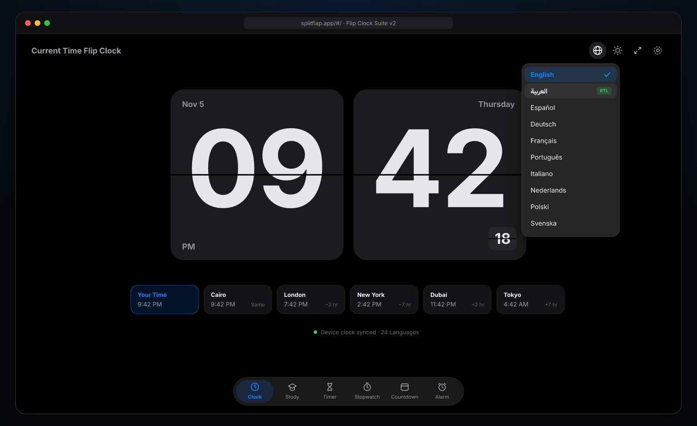
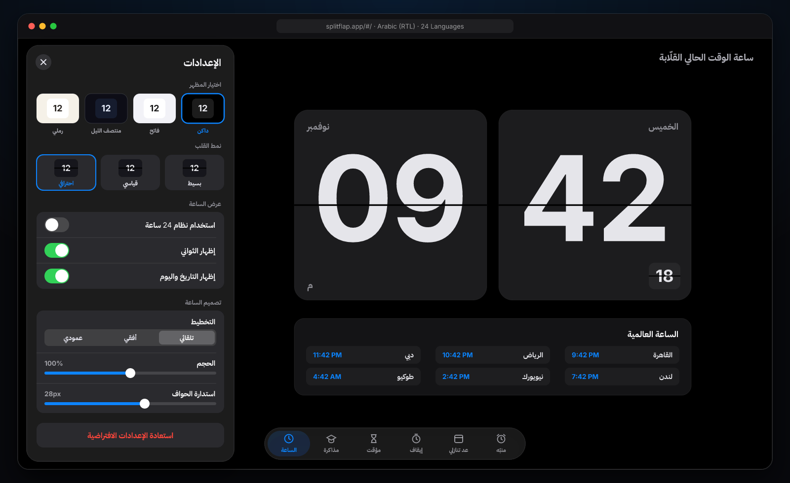
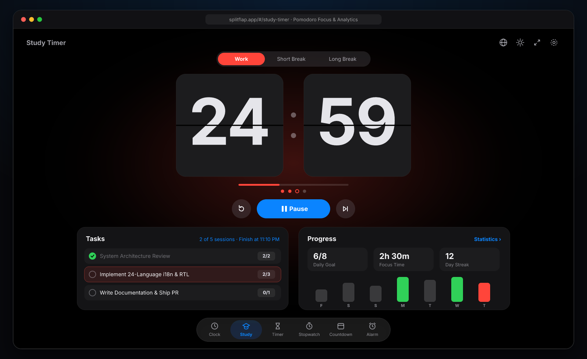
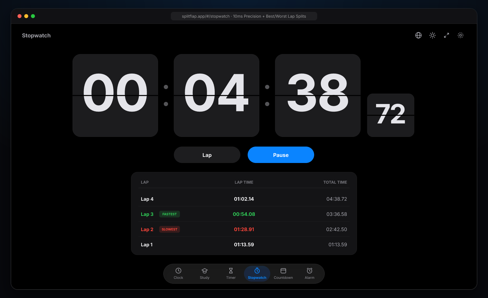
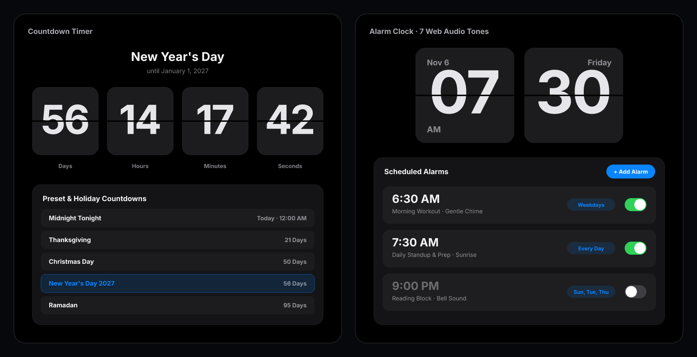
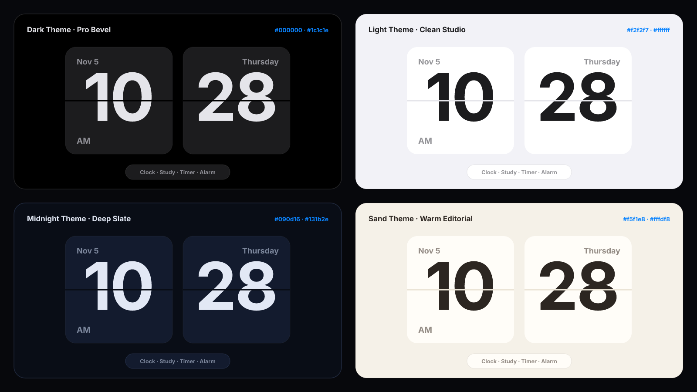

<div align="center">

# ⏱️ SplitFlap — Minimalist 3D Flip Clock & Time Suite

### **ساعة قلّابة احترافية متكاملة بـ 6 أدوات زمنية، 4 مظاهر، و24 لغة منها العربية (RTL)**

<p>
  
  
  
  
  
</p>

<p>
  <a href="#-live-gallery--screenshots"><b>📸 Screenshots</b></a> •
  <a href="#-6-in-1-time-suite"><b>⚡ 6-in-1 Suite</b></a> •
  <a href="#-24-languages--native-arabic-rtl"><b>🌍 24 Languages + العربية</b></a> •
  <a href="#-themes--3d-split-flap-physics"><b>🎨 Themes & Physics</b></a> •
  <a href="#-quick-start"><b>🚀 Quick Start</b></a>
</p>

<br />



</div>

---

## ✨ Why SplitFlap?

**SplitFlap** brings the tactile elegance of classic mechanical departure boards to the browser with Apple-inspired dark-room precision, zero external audio assets, and complete offline-capable persistence.

- **Authentic 3D Split-Flap Physics** — Hardware-accelerated 4-layer hinged flap cards (`top`, `bottom`, `flap-front`, `flap-back`) with perspective depth, dynamic shadow seams, and **3 visual styles** (*Simple*, *Standard*, *Professional*).
- **6 Complete Time Tools in One Floating Dock** — Instant zero-reload switching between **Clock (+ World Clock)**, **Study Timer (Pomodoro)**, **Timer**, **Stopwatch**, **Countdown**, and **Alarm**.
- **24 Languages + First-Class Arabic (`العربية`) RTL** — Native right-to-left sheet mirroring, Arabic typography, localized `Intl.DateTimeFormat` calendar dates & weekdays, while preserving universal `HH : MM : SS` card order.
- **Pure Web Audio Synthesizer** — **7 rich alarm & focus tones** (*Bell*, *Classic*, *Beacon*, *Sunrise*, *Gentle Chime*, *Digital Beep*, *Short Melody*) + optional mechanical focus ticking, generated in real time with zero `.mp3` files.

---

## 📸 Live Gallery & Screenshots

### 🌍 Native Arabic (`العربية`) RTL + Per-Tool Settings Sheet



<br />

### 🎓 Pomodoro Study Timer & ⏱️ 10ms Precision Stopwatch

| **Pomodoro Focus, Tasks & 7-Day Analytics** | **Centisecond Stopwatch & Best/Worst Lap Splits** |
| :---: | :---: |
|  |  |

<br />

### 📅 Event Countdowns & 🔔 Multi-Schedule Alarm Clock



<br />

### 🎨 4 Curated Studio Themes (`Dark` · `Light` · `Midnight` · `Sand`)



---

## ⚡ 6-in-1 Time Suite

| Tool | Highlights |
| :--- | :--- |
| **🕰️ Flip Clock & World Clock** | Live 12h / 24h split-flap clock, optional seconds & date/weekday badges, **24 global cities** (including Cairo, Riyadh, Dubai, London, NYC, Tokyo), solar sunrise/sunset times, and interactive **±24h Time Zone Planner** slider. |
| **🎓 Study Timer (Pomodoro)** | Ambient session glow (*Red* Work · *Green* Short Break · *Blue* Long Break), *Classic 25-5-15* / *Short 15-3-9* / *Long 50-10-30* presets, **Task Estimator** with projected finish time, streak counter, 7d / 30d / 12m charts, and **CSV Export**. |
| **⏳ Countdown Timer** | 16 one-tap duration chips (`15 sec` → `60 min`), custom `HH : MM : SS` fields, live progress bar, continuous ring-until-stopped mode, and quick-launch timer directory. |
| **⏱️ Stopwatch** | High-precision `requestAnimationFrame` engine with baseline-aligned **centiseconds** flap card (`1/100s`) and live split table highlighting **Fastest Lap** in green and **Slowest Lap** in red. |
| **📅 Event Countdown** | 4-unit `Days · Hours · Minutes · Seconds` display, custom date/time event creator, quick presets (*Midnight*, *Noon*, *Evening*), and live upcoming holiday countdown directory. |
| **🔔 Alarm Clock** | Multiple persistent browser alarms, weekday repeat chips (*Once*, *Every Day*, *Weekdays*, *Weekends*, or custom days), gradual volume ramp, and configurable snooze duration (`1–30 min`). |

---

## 🌍 24 Languages + Native Arabic RTL

Switch instantly from the top-bar Globe menu (`.language-switcher`) across all **24 supported locales**:

> `English` · **`العربية (RTL)`** · `Español` · `Deutsch` · `Français` · `Português` · `Italiano` · `Polski` · `Русский` · `Українська` · `Čeština` · `Suomi` · `Bahasa Indonesia` · `日本語` · `Nederlands` · `ไทย` · `繁體中文` · `Tiếng Việt` · `Dansk` · `Magyar` · `Norsk` · `Ελληνικά` · `Svenska` · `한국어`

---

## ⌨️ Keyboard Shortcuts

| Key | Action |
| :---: | :--- |
| <kbd>Space</kbd> | **Start / Pause / Resume** active Study session, Timer, or Stopwatch |
| <kbd>F</kbd> | Toggle distraction-free **Fullscreen Mode** (or double-click to exit) |
| <kbd>L</kbd> | Record a **Lap Split** while Stopwatch is running |
| <kbd>R</kbd> | **Reset** Stopwatch when paused |
| <kbd>Esc</kbd> | Close open Settings drawer, modals, or dismiss active alarm ring |

---

## 🚀 Quick Start

```bash
# 1. Install dependencies
npm install

# 2. Start local development server
npm run dev

# 3. Build optimized production bundle
npm run build

# 4. (Optional) Build portable single-file HTML bundle
npm run build:single
```

---

## 🗂️ Project Structure

```text
├── docs/screenshots/          # High-DPI Retina UI showcase screenshots
├── src/
│   ├── components/
│   │   ├── FlipCard.tsx       # 3D split-flap card, colon & centisecond components
│   │   ├── HeaderNav.tsx      # Top bar, 24-language dropdown & floating bottom dock
│   │   ├── SettingsDrawer.tsx # Context-aware per-tool settings sheet
│   │   └── Footer.tsx         # Quick navigation footer
│   ├── pages/
│   │   ├── ClockPage.tsx      # Flip Clock + World Clock + SunCalc + Time Planner
│   │   ├── StudyPage.tsx      # Pomodoro timer, tasks & 7d/30d/12m analytics
│   │   ├── TimerPage.tsx      # Duration timer + 16 presets + custom H:M:S
│   │   ├── StopwatchPage.tsx  # 10ms stopwatch + best/worst lap splits
│   │   ├── CountdownPage.tsx  # 4-card event & holiday countdowns
│   │   └── AlarmPage.tsx      # Scheduled repeating browser alarms + snooze
│   ├── utils/
│   │   ├── soundEngine.ts     # 7-profile Web Audio synthesizer & alarm loop
│   │   └── storage.ts         # Safe typed localStorage persistence
│   ├── i18n.ts                # 24-language dictionary + RTL metadata
│   ├── types.ts               # Shared TypeScript interfaces & defaults
│   └── index.css              # Design tokens, 4 themes, 3 flip looks & RTL rules
└── package.json
```

<div align="center">
  <sub>Built with precision · Zero external trackers · 100% client-side privacy</sub>
</div>
